<p align="center">
  
</p>

# Velora

Velora is a Flutter shopping app for discovering products, saving favorites, and managing a shopping bag. Explore a live catalog, compare product details and reviews, and try a PayHere Sandbox payment flow. The interface includes an animated splash screen, a welcome screen, and coordinated light and dark themes.

[Features](#features) · [Screenshots](#screenshots) · [Getting started](#getting-started) · [Architecture](#how-it-works) · [Tests](#tests)

## Features

- **Product discovery:** browse a live, paginated catalog with search and category filters.
- **Filtering and sorting:** set a maximum discounted price or sort by list price and product title.
- **Product details:** view galleries, descriptions, discounts, stock availability, ratings, reviews, and related products.
- **Wishlist:** save favorites, keep them synchronized across shopping screens, and keep them after a restart.
- **Shopping bag:** adjust quantities within available stock, review totals, refresh prices and inventory, and keep the bag after closing the app.
- **Fast images:** product photos are cached on the device, so they load instantly after the first view.
- **Sandbox checkout:** review the bag, enter customer details, and try simulated payments through the PayHere SDK.
- **Local profile:** edit your name, email, and phone number, and select a profile photo from the gallery.
- **Catalog alerts:** optionally receive local notifications for new arrivals and discount changes while the app is active.
- **Welcome experience:** animated branding and a welcome screen introduce the app before shopping.
- **Light and dark themes:** switch appearance from **Profile → Dark Mode**.

## Screenshots

### First launch

| Splash screen | Welcome screen |
|:---:|:---:|
|  |  |

### Everyday use

| Home | Product details | Shopping bag |
|:---:|:---:|:---:|
| 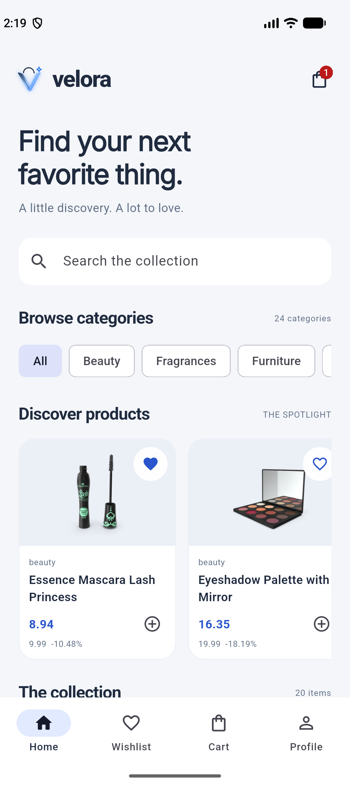 | 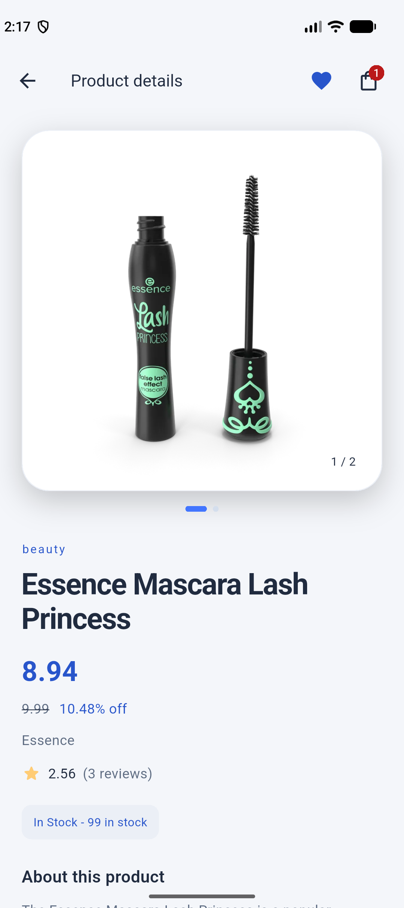 | 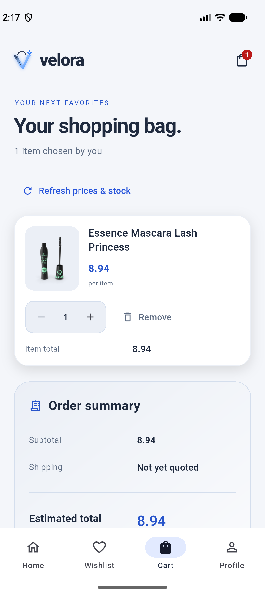 |

| Wishlist | Profile |
|:---:|:---:|
| 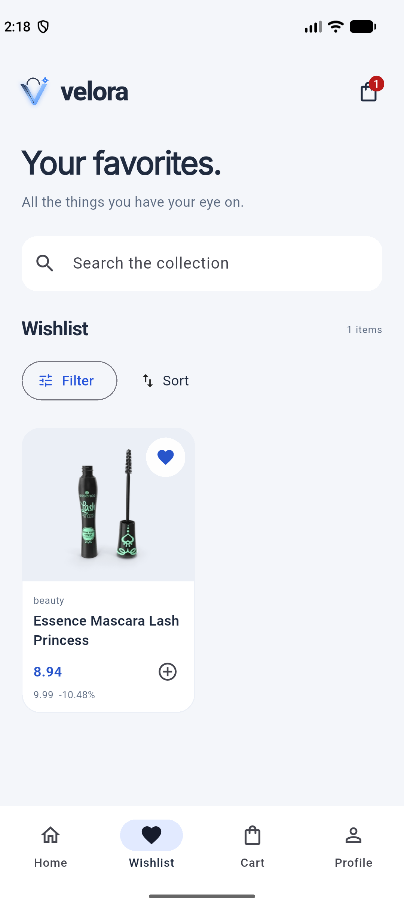 | 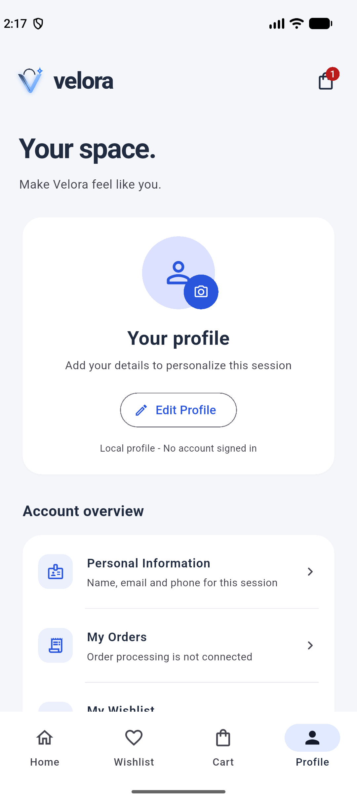 |

### Browsing

<p align="center">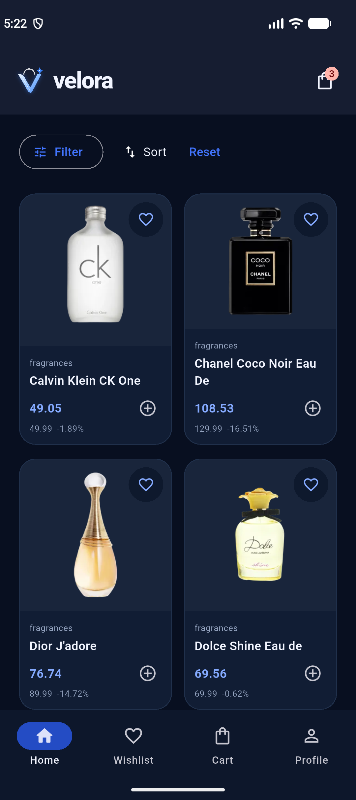</p>

### Dark mode

| Home | Product details | Shopping bag |
|:---:|:---:|:---:|
| 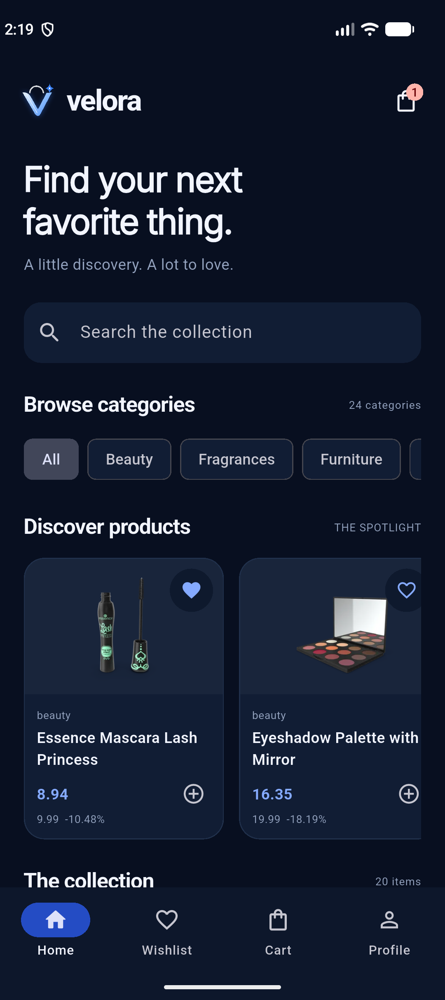 | 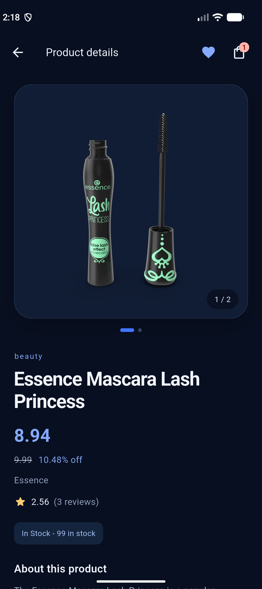 | 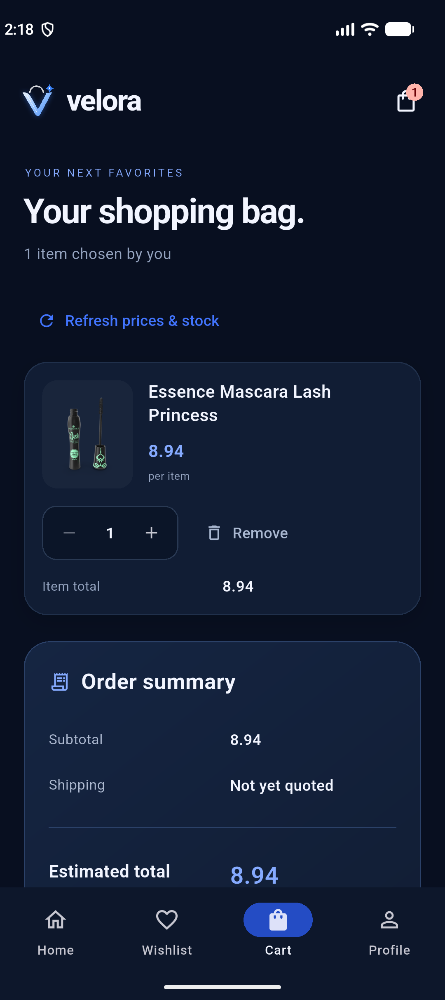 |

| Wishlist | Profile |
|:---:|:---:|
| 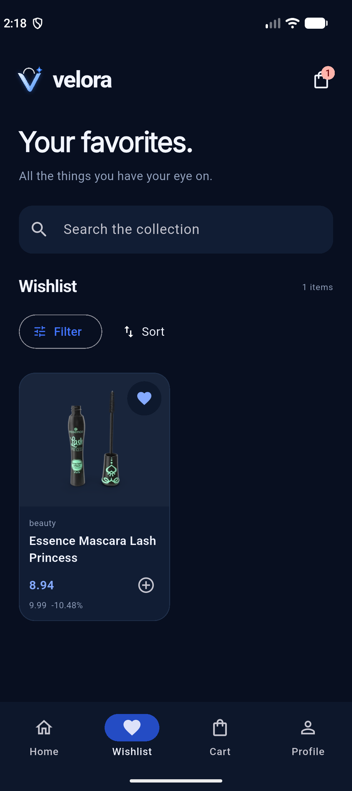 | 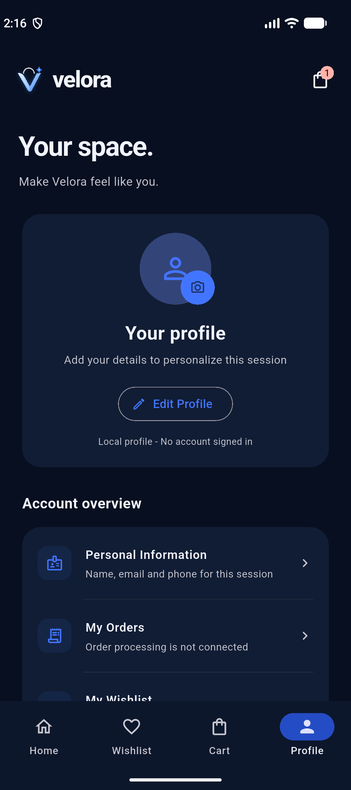 |

## Built with

| Area | Choice |
|---|---|
| Framework | Flutter / Dart with Material 3 |
| Product catalog | DummyJSON Products API |
| Networking | `http` |
| State management | `provider` with `ChangeNotifier` (`ProductProvider`, `ShopState`, `AppSettings`) |
| Image caching | `cached_network_image` |
| Local preferences | `shared_preferences` |
| Notifications | `flutter_local_notifications` |
| Profile photo | `image_picker` |
| Demo payments | `payhere_mobilesdk_flutter` |
| Typography | Bundled Inter font |

## How it works

- **Data access:** `ProductApiService` handles HTTP requests, timeouts, response validation, and parsing. An injectable `ProductRepository` separates the API from the interface.
- **Catalog state:** `ProductProvider` manages search debounce, categories, pagination, filtering, sorting, and protection against stale requests. Product details load independently by ID.
- **Shared shopping state:** `ShopState` keeps cart quantities, favorites, and totals consistent across screens. Inventory refresh reconciles changed prices, reduced stock, and unavailable products.
- **Pricing:** discounted unit prices are rounded to two decimals; cart calculations use integer cents. Price sorting uses the original API list price, while maximum-price filtering uses the discounted price.
- **Catalog alerts:** `CatalogAlertService` compares the full catalog with a saved snapshot. Checks run when enabled in the foreground and repeat every 15 minutes; they stop when the app leaves the foreground.
- **Payment attempts:** `SandboxPaymentService` captures the cart before opening PayHere and blocks duplicate attempts. Completion clears the bag; failure or cancellation keeps its contents.
- **Appearance and profile:** `AppSettings` manages local profile information and theme changes without recreating the shopping state.

### What is saved

| Data | Storage and lifetime |
|---|---|
| Cart and wishlist | Local SharedPreferences, restored on the next launch (`CartStorage`) |
| Profile details and photo | In memory; no upload or authenticated account |
| Theme and language preferences | In memory for the current session |
| Notification preference and catalog comparison snapshot | Local SharedPreferences |
| Payment result | Session-only SDK result; no persistent order record |

The catalog and remote images require internet access. English is the available translation. Product data does not supply a standard currency field, so the whole app (cards, details, bag, and Sandbox checkout) shows numeric prices as **LKR demo prices**, without currency conversion.

## Project structure

```text
lib/
  main.dart                     App startup and service lifecycle
  data/                         API client and repository interface
  models/                       Product, review, category, and page models
  screens/                      Welcome, catalog, details, cart, profile, checkout
  services/                     Cart storage, photo selection, notifications, alerts, payments
  state/                        Catalog, shopping state, and local settings
  theme/                        Material 3 light and dark themes
  widgets/                      Product cards, profile components, branding
assets/
  branding/                     App icon artwork
  fonts/                        Bundled Inter font
config/payhere.example.json     Sandbox configuration template
scripts/run_payhere_sandbox.ps1  PowerShell Sandbox launcher
screenshots/                    Images used in this README
test/                           Unit, widget, and optional live API tests
PAYHERE_SANDBOX.md              Sandbox setup and manual testing guide
```

## Getting started

Prerequisites:

- Flutter SDK with Dart compatible with `^3.10.4` (Dart 3.10.4 or newer, below 4.0.0).
- An Android device or emulator with the Android toolchain configured.
- Internet access for the product catalog and images.

Clone the repository and open the project:

```sh
git clone https://github.com/DuminduMalinga/Velora.git
cd Velora
```

Install dependencies and launch:

```sh
flutter doctor
flutter pub get
flutter run
```

### PayHere Sandbox configuration

Copy `config/payhere.example.json` to `config/payhere.local.json` and supply your app-specific Sandbox credentials following the [PayHere Sandbox guide](PAYHERE_SANDBOX.md).

From PowerShell:

```powershell
$env:DEBUG = ''
flutter run --dart-define-from-file=config/payhere.local.json
```

Clearing `DEBUG` prevents the Windows Gradle wrapper from echoing build configuration values. The local JSON file is excluded from source control. Compiler defines are embedded in the application, so use Sandbox credentials only and keep credential-bearing build artifacts private.

Alternatively, use the launcher that temporarily clears `DEBUG`:

```powershell
./scripts/run_payhere_sandbox.ps1 -DeviceId <android-device-id>
```

Restart the app after changing configuration. The Sandbox guide covers customer fields, test cards, SDK callbacks, and device checks.

### API configuration

The default API base URL is `https://dummyjson.com`. To use a compatible deployment:

```sh
flutter run --dart-define=API_BASE_URL=https://your-compatible-api.example
```

Supply the base URL without a `/products` suffix. A browser deployment requires the API to allow the application's origin through CORS.

### Platform notes

- Android is the validated target for the PayHere integration. iOS requires macOS, Xcode, CocoaPods, and PayHere's iOS setup; it has not been built here.
- Web and desktop do not support this payment flow and display a setup error while preserving the cart.
- System notifications are available on Android and iOS, subject to device permission. Catalog checks do not run as a background service while the app is closed.
- Native photo selection and permission dialogs require a manual device check.

## Tests

```sh
flutter analyze
flutter test --dart-define=PAYHERE_MERCHANT_SECRET=test-fixture
```

The merchant value above is a dummy test fixture. Tests cover cart calculations, stock limits, profile validation, photo-picker handling, themes, onboarding, catalog alerts, notification behavior, and Sandbox payment state and callbacks.

Live API tests are opt-in:

```sh
flutter test --dart-define=PAYHERE_MERCHANT_SECRET=test-fixture --dart-define=RUN_LIVE_API_TESTS=true
```

These tests exercise real API mapping, images, product discovery, pricing, inventory, and shopping navigation. They require internet access and depend on external API and image CDN availability. Automated payment callbacks do not verify an end-to-end PayHere transaction; follow the manual scenarios in [PAYHERE_SANDBOX.md](PAYHERE_SANDBOX.md).

## Project scope

| Area | Current implementation |
|---|---|
| Product browsing | Live catalog, categories, search, filters, and pagination |
| Shopping interactions | Saved wishlist, saved stock-aware cart, and inventory refresh |
| Profile | Local editing and gallery photo selection |
| Notifications | Optional foreground catalog monitoring and local alerts |
| Checkout | Customer details and simulated PayHere Sandbox payments |
| Orders and accounts | No persistent order backend or authenticated account service |
| Shipping | Unquoted and excluded from totals unless a quote is supplied |
| Payment verification | SDK callbacks only; no server-side notification verification |

Sandbox completion is a demo result. Production checkout requires a trusted backend to validate prices and stock, store orders, and verify gateway notifications before fulfillment. See the [Sandbox guide](PAYHERE_SANDBOX.md#production-requirements) for the integration requirements.
